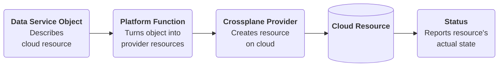

# Overview

The Portable Data Service APIs give each data service in
[`platform-apis`](https://github.com/entigolabs/platform-apis), from PostgreSQL to buckets, one form
that every cloud infralib deploys to can implement with its own managed service. One manifest then
works on AWS, GCP, OCI and Azure alike.

*The path from a data service object to its resource on the deployment's cloud.*

Today each API is built around one AWS service: its spec takes AWS values, such as an RDS instance
class, its status reports AWS identifiers, and the developer portal hard-codes AWS values in its
forms. infralib also deploys to GCP, OCI and Azure, and OCI is the next cloud to run the data
services.

The parts the design is built from are defined in [Model](model.md), the rules it follows in
[Principles](principles.md), the mechanisms that apply them in [Common Design](common-design.md),
and the changes for today's users in [API Changes](changes.md).

Status: a draft awaiting the agreement of the `platform-apis` maintainers, tracked in
[RMIT-44](https://entigo.atlassian.net/browse/RMIT-44).

## Goals

The design meets these goals:

- One manifest of a kind applies on every deployment that offers the kind, on any cloud or
  on-premises.
- A new implementation never changes the schema of a user-facing kind.
- One manifest can carry the settings of several implementations at once.
- Machine sizes use each product's own names, and the platform keeps no mapping between clouds.
- Entigo sets each deployment's defaults, and the values a user may not change, as data rather than
  code.
- A capability an implementation cannot provide is refused when requested, never dropped silently.
- Read replicas and disaster recovery across regions are portable wherever an implementation
  supports them.
- Each service has few kinds: its user-facing kinds, a class, engine parameters where the engine
  has its own settings, and one provider configuration kind per implementation.

## Non-goals

The design leaves these out:

- Implementing the design on each cloud, and moving today's objects to it, are follow-up work.
- A copy on a newer major version, and replication between clouds, use logical replication and
  belong to upgrades and migration.
- Bounds on the values a user may choose, such as permitted sizes or a storage maximum, beyond the
  fixed values of a class; allowed values can be added to a class later without changing the rest.
- Access for persons is outside the user kinds, which cover applications only.

## Pages

Each page of the design holds the following, in the order of the menu:

- [Model](model.md): the parts every data service API is built from.
- [Principles](principles.md): the rules every data service API follows, and the reason for each.
- [Common Design](common-design.md): the mechanisms that apply the principles to every service.
- [Service Designs](postgresql.md): the design of each service, its mapping to each cloud and the
  draft schemas of its kinds.
- [API Changes](changes.md): every change from today's APIs to the design, per kind.
- [Related Work](related-work.md): the projects the design draws on, and the alternatives it was
  chosen over.
- [Open Points](open-points.md): questions to decide before implementation.
- [Follow-Up Work](follow-up-work.md): work outside the design that it depends on or leads to.
- [Deferred Capabilities](deferred-capabilities.md): capabilities considered and omitted for now.
- [Revisions](revisions.md): the design's revisions, newest first.
- [Feedback](#feedback), on the published page only: comments from reviewers, readable by
  everyone with access to the page.
