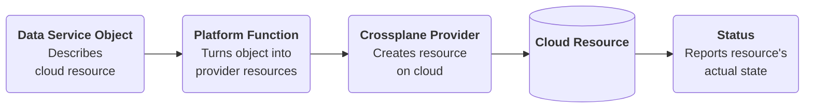

# Overview

The Portable Data Service APIs give each data service in
[`platform-apis`](https://github.com/entigolabs/platform-apis), from PostgreSQL to buckets, one form
that every cloud infralib deploys to can implement with its own managed service. One manifest then
works on AWS, GCP, OCI and Azure alike.

*The path from a data service object to its resource on the deployment's cloud.*

Today each API is built around one AWS service: its spec takes AWS values, such as an RDS instance
class, its status reports AWS identifiers, and the developer portal hard-codes AWS values in its
forms. infralib also deploys to GCP, OCI and Azure, and OCI is the next cloud to run the data
services.

Status: a draft awaiting the agreement of the `platform-apis` maintainers, tracked in
[RMIT-44](https://entigo.atlassian.net/browse/RMIT-44).

## In Scope

The design covers seven data services: PostgreSQL, MariaDB, Valkey, Kafka, RabbitMQ, buckets and
artifact repositories. For each, it defines the kinds a user writes, the classes and provider
configurations that shape them, the status and connection secret every implementation reports, the
managed service each cloud implements it with, and the changes from today's API.

## Out of Scope

The design leaves these out:

- Implementing the design on each cloud, and moving today's objects to it, are follow-up work.
- Read replicas for PostgreSQL and MariaDB, and disaster recovery across workspaces, are
  [deferred capabilities](deferred-capabilities.md).
- A copy on a newer major version, and replication between clouds, use logical replication and
  belong to upgrades and migration.
- Bounds on the values a user may choose, such as permitted sizes or a storage maximum, beyond the
  fixed values of a class; allowed values can be added to a class later without changing the rest.
- Access for persons is outside the user kinds, which cover applications only.

## Pages

The menu groups the pages of the design:

- **Design:** [Model & Principles](principles.md), the parts every data service API is built from
  and the rules each follows; [Common Design](common-design.md), the mechanisms every service
  shares, and [Service Designs](postgresql.md), a page per service; [API Changes](changes.md), every
  change from today's APIs per kind, and [Related Work](related-work.md).
- **Open items:** [Open Points](open-points.md), [Follow-Up Work](follow-up-work.md) and
  [Deferred Capabilities](deferred-capabilities.md).

[Revisions](revisions.md) lists the design's revisions, newest first, and [Feedback](#feedback), on
the published page only, holds comments from reviewers, readable by everyone with access to the
page.
