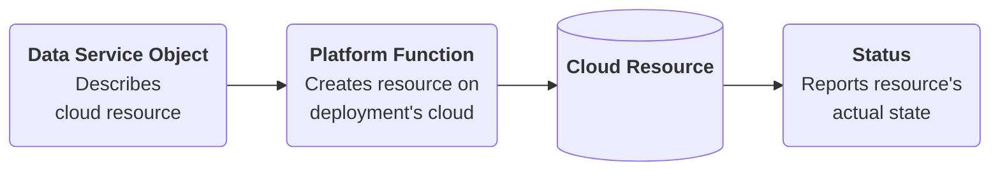

# Overview

The Portable Data Service APIs give each data service in
[`platform-apis`](https://github.com/entigolabs/platform-apis), from PostgreSQL to buckets, one form
that every cloud infralib deploys to can implement with its own managed service. One manifest then
works on AWS, GCP, OCI and Azure alike.

Today each API is built around one AWS service: its spec takes AWS values, such as an RDS instance
class, its status reports AWS identifiers, and the developer portal hard-codes AWS values in its
forms. infralib also deploys to GCP, OCI and Azure, and OCI is the next cloud to run the data
services. Implementing the design on a cloud and moving today's objects to it are follow-up work.

The rules the design follows are in [Design Rules](rules.md), and what changes for today's users is
in [API Changes](changes.md).

Status: a draft awaiting the agreement of the `platform-apis` maintainers, tracked in
[RMIT-44](https://entigo.atlassian.net/browse/RMIT-44).

## Pages

What each page of the design holds, in the order of the menu.

- [Design Rules](rules.md): the rules every data service API follows, and the alternatives weighed
  against them.
- One page per service, showing how it applies the rules: [PostgreSQL](postgresql.md),
  [MariaDB](mariadb.md), [Valkey](valkey.md), [Kafka](kafka.md), [RabbitMQ](rabbitmq.md),
  [Bucket](bucket.md) and [ArtifactRepository](artifact-repository.md). The site shows each in
  three tabs: its design, how each cloud implements it (Mapping and Cloud Limits), and the draft
  schemas of its kinds from [schemas](schemas/).
- [API Changes](changes.md): every change from today's APIs to the design, per kind.
- [Follow-Up Work](follow-up-work.md): work outside the design that it depends on or leads to.
- [Deferred Capabilities](deferred-capabilities.md): capabilities considered and omitted for now.
